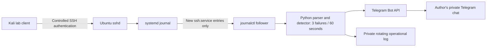

# LAB-02-002 | Controlled end-to-end SSH monitoring test

**Date:** 2026-11-04. **Classification:** Benign, author-reported controlled lab activity; no real attack or compromise established.

## Scenario and architecture

The author reports intentionally generating three failed password authentications
from their owned Kali VM to their Ubuntu host. The actual private addresses are
omitted from portfolio artifacts. Here, `192.0.2.101` represents the lab client and
`192.0.2.1` represents the lab server; both are documentation addresses, not usable
instructions for the actual network. Kali's operating system, ownership and test
intent are supplied by the author, not proven by journal entries.

## Independently reviewed evidence

A read-only `journalctl` query for `ssh.service` between 23:51:00 and 23:53:00 UTC
returned three parseable `Failed password` events matching the reported source.
It completed successfully without permission warnings. Each entry represents a
password failure; related PAM and connection messages were not counted again.

| Failure | Original timestamp (UTC−03:00) |
| --- | --- |
| 1 | 2026-11-04T20:51:32-03:00 |
| 2 | 2026-11-04T20:51:53-03:00 |
| 3 | 2026-11-04T20:52:00-03:00 |

The existing detector returns one threshold crossing: three failures in **28
seconds**, inside the inclusive 60-second window. The
[parser-compatible anonymized derivative](evidence/LAB-02-002-parseable-anonymized.txt)
preserves these timestamps and event type. Hostname, account, IP, PID and port
were replaced with fictitious values. It is derived from actual lab records,
not synthetic input and not an unmodified raw export. Its comments are ignored
by the parser. It must not be used to infer original PIDs, accounts or ports.

The [sanitized operational excerpt](evidence/LAB-02-002-monitor-sanitized.txt)
records follower startup at 20:48:59 and Telegram API acceptance of a detection
at 20:52:12.084 (host-local UTC−03:00). At the time of that earlier review, the
reviewed log contained no ERROR entries; a later connection error and exit are
documented in [LAB-02-003](LAB-02-003-hydra-exercise.md). The 12.084-second difference from the final journal event is an observed
interval, not a measured or guaranteed delivery latency. The operational message
contains no source or event identifier, so its association with this test rests
on timing and the author's matching alert report, not an independently stored
correlation ID.

## Telegram receipt reported by the author

The author confirms receiving an alert with the matching source (represented
here as `192.0.2.101`), count 3, first timestamp 20:51:32 and last timestamp
20:52:00, both UTC−03:00. It also stated `Indicative severity: medium (not
validated)` and required investigation. No Telegram screenshot, API response,
chat ID or credentials are included. API acceptance is independently recorded;
phone display and alert content are author-reported.

## Interpretation and limits

This completes the first author-confirmed live demonstration of journal → Python
threshold detection → Telegram receipt. It validates this particular controlled
path, not a production detection policy, uptime, attack attribution or compromise.
The medium label is illustrative and unvalidated. Mistyped passwords and shared
addresses can trigger this rule. Successful login correlation, other SSH failure
formats, distributed sources, restart persistence and guaranteed delivery remain
outside this demonstration. No new attempts or SSH configuration changes were
made during evidence review. AI assisted implementation, verification,
anonymization and documentation; the human author performed the controlled test
and confirmed receipt.

## Reproduce only in an authorized lab

1. Use an already approved, owned Kali-to-Ubuntu topology with SSH configured.
   Confirm actual private addresses locally; do not substitute the documentation
   addresses above into commands or expose SSH publicly.
2. Configure Telegram once with `python3 telegram_alerts.py setup`, if needed.
3. Follow the README's detached-run instructions; first confirm no existing
   monitor is active. Verify its PID, journalctl child and startup log.
4. On Kali, manually use `ssh LAB_USER@LAB_SERVER` against that owned server and
   intentionally enter an incorrect password three times within 60 seconds.
   Depending on server policy, this may require separate connections. Do not
   automate guessing, alter SSH policy or use real passwords. Stop after three
   failed password submissions; prompts alone do not prove logged failures.
5. Review the corresponding local `ssh.service` journal interval and confirm
   exactly which `Failed password` entries were recorded. Keep raw logs private.
6. Confirm the operational API-acceptance entry and independently inspect the
   received Telegram alert. Record actual count, source and timestamps locally;
   anonymize evidence before sharing. Extra failures are not required.
7. Stop the monitor using its verified PID if the demonstration is finished.

These are future manual reproduction instructions, not actions performed during
this evidence review. No additional authentication attempts were generated.
