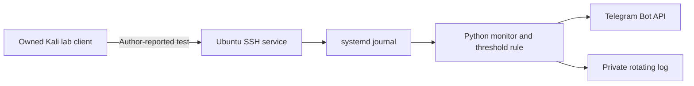

# 02 | SSH Authentication & Detection

**Status:** Partially completed. A controlled end-to-end alert demonstration is documented; a successful-login baseline and the separate Hydra-to-alert correlation remain unverified.

[← Portfolio overview](../README.md) · [Complete technical guide](TECHNICAL_GUIDE.md)

## What I built

A small, testable monitoring workflow for **repeated SSH password failures** on an owned Linux laboratory system.

- **Log parser:** reads OpenSSH `Failed password` records in `journalctl -o short-iso` format and extracts timestamps and source IPs.
- **Detection logic:** identifies **three failures from the same source within 60 seconds** using a sliding window, with basic alert suppression and rearming.
- **Live monitor:** follows new `ssh.service` journal entries and applies the same rule.
- **Telegram notification:** sends a concise detection summary; test and offline simulation modes are available.
- **Operational safeguards:** private credential storage, sanitized operational logging, a lock for the background runner, and error handling without unsafe automatic message retries.

**Stack:** Ubuntu, OpenSSH, `journalctl`, Python standard library, `unittest`, Telegram Bot API, Kali/VirtualBox in an authorized lab.

## Workflow



The topology is based in part on the author's account. The full network configuration was not independently verified in the reviewed reports.

## Results and evidence

| Case | What is supported | What is not proven |
| --- | --- | --- |
| [LAB-02-001 — Single controlled SSH failure](LAB-02-001-controlled-ssh-failure.md) | One `Failed password` record was confirmed; it does **not** meet the default threshold | A broader SSH baseline, attack or compromise |
| [LAB-02-002 — End-to-end alert](LAB-02-002-end-to-end-ssh-monitor.md) | Three journal-confirmed failures occurred within **28 seconds**. The operational log records Telegram API acceptance; the author reports a matching received alert | Guaranteed delivery, production reliability or a hostile attack |
| [LAB-02-003 — Controlled Hydra exercise](LAB-02-003-hydra-exercise.md) | **23** SSH `Failed password` records appeared in the reviewed time window. The author reports performing the exercise | Independent attribution to Hydra or a reliable correlation between this burst and the claimed Telegram alert |

The third case is deliberately left **partially verified**: an available monitor log records a connection failure and exit before the later event window. The reports distinguish observed records from author-reported context.

## Reproduce without attacking anything or sending alerts

From the repository root, use the existing synthetic sample:

```bash
cd 02-ssh-detection
python3 detect_ssh_failures.py synthetic/ssh-sample.txt
python3 detect_ssh_failures.py synthetic/ssh-sample.txt --threshold 4 --window-seconds 60
python3 -m unittest -v
```

The sample is synthetic and contains documentation-range addresses. The first command is designed to report **one detection**; the higher-threshold example is designed to report **none**. The codebase contains **30 defined tests**, with Telegram calls mocked. Their latest execution status was not verified as part of this documentation update.

For live monitoring setup, credentials, operating instructions, precise parser behavior, limitations and safe-reproduction steps, read the [technical guide](TECHNICAL_GUIDE.md). Do not expose an SSH server to the Internet for this lab.

## Remaining work

- Establish and document a confirmed successful SSH login baseline.
- Repeat and independently correlate a controlled event, monitor record, and Telegram alert before closing the Hydra-related gap.
- Improve operational resilience and test behavior during disconnects, restarts, and gaps if the scope expands.
- Complete a private-data and Git-history audit before publication.

## Scope and integrity

This is a personal learning exercise, not a production SOC detector or proof of malicious activity. IPs and identifying information are anonymized or synthetic where indicated. Credentials stay outside the repository. Implementation and documentation received AI assistance; the author is responsible for testing, understanding and validating the observations.
