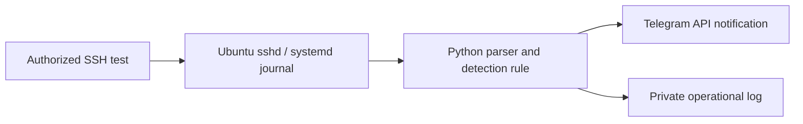

# Cybersecurity Portfolio | SOC & Technical Operations Labs

**Hands-on Linux investigation, Python-based detection, and technical monitoring.**

A practical learning portfolio exploring how to investigate system events, build small monitoring tools, verify findings, and document incidents clearly.

> **Personal lab, in progress.** This work does not represent professional SOC employment, production monitoring, or confirmed malicious incidents. Real observations, controlled tests, simulated data, and unverified results are labeled separately.

## At a glance

| Project | What I worked on | Status |
| --- | --- | --- |
| [01 — Linux Security Log Investigation](01-linux-log-investigation/README.md) | Investigated privileged execution and local authentication failures using `journalctl`; produced two evidence-based triage reports | **Completed for the documented learning scope** |
| [02 — SSH Authentication & Detection](02-ssh-detection/README.md) | Built a Python SSH failure detector, live journal monitor, and Telegram notification workflow; documented controlled tests | **Partially completed**; some correlation and baseline checks remain |

**Core tools:** Ubuntu Linux, `journalctl`, OpenSSH logs, Python, `unittest`, Telegram Bot API, VirtualBox/Kali Linux (authorized lab only).

**Relevant areas:** log analysis, structured troubleshooting, technical monitoring, incident triage, evidence handling, documentation, and basic Python automation.

## Featured: SSH failure detection and alerting

A small Python monitor follows new SSH authentication events, applies a **three failed passwords from one source within 60 seconds** demonstration rule, and sends a concise notification through the Telegram Bot API.



**What was observed:** In a controlled test on November 4, 2026, three `Failed password` records appeared within **28 seconds**. An operational log recorded Telegram API acceptance afterward, and the author reported receiving the corresponding notification. This establishes a specific lab demonstration, **not** guaranteed alert delivery or detection of a real attack.

**What remains unresolved:** A separate author-reported Hydra exercise produced 23 SSH failure records in the examined window, but the available records **do not establish that the reported alert came from that exercise**. A successful-login baseline also remains unverified.

[Explore the SSH lab](02-ssh-detection/README.md) · [Read the controlled end-to-end report](02-ssh-detection/LAB-02-002-end-to-end-ssh-monitor.md) · [Read the limitations of the separate exercise](02-ssh-detection/LAB-02-003-hydra-exercise.md)

## Featured: Linux log investigation

Two small triage cases demonstrate a cautious, evidence-first approach:

- **Privileged execution:** reviewed `pkexec` / `update-notifier` activity alongside package-management events; assessed it as **probably legitimate, provisionally**, without asserting proof of origin or file integrity.
- **Authentication failure:** analyzed a controlled `su` password failure from the Linux journal, distinguishing the recorded event from the author's description of the test.

[Explore the Linux lab](01-linux-log-investigation/README.md) · [Privileged execution report](01-linux-log-investigation/analysis-report.md) · [Authentication failure report](01-linux-log-investigation/LAB-01-002-analysis-report.md)

## Try the offline detector

This example reads **synthetic data** and does not attempt SSH logins, access the live journal, or contact Telegram.

```bash
cd 02-ssh-detection
python3 detect_ssh_failures.py synthetic/ssh-sample.txt
python3 -m unittest -v
```

The synthetic file is designed to produce one detection using the default threshold. The project includes **30 defined Python test functions**; this README does not claim that they were freshly executed or all passed on the latest commit. See the [SSH technical guide](02-ssh-detection/TECHNICAL_GUIDE.md) for setup, constraints, commands, and implementation details.

## Next steps

- Verify the successful SSH authentication baseline and the missing event-to-alert correlation for the Hydra exercise.
- Improve reproducibility and validate the automated tests before publication.
- Add small, well-documented investigations rather than treating the [eight-project roadmap](docs/ROADMAP.md) as completed work.

## Integrity, privacy, and collaboration

All investigative activity is restricted to owned or expressly authorized environments. Evidence is sanitized or synthetic where stated, and raw machine logs, credentials, and private identifiers must stay out of Git. A current-file review is **not** a complete audit of Git history: see the [publication checklist](docs/PUBLICATION_CHECKLIST.md) before making the repository public.

The author performs and validates lab exercises, interprets the evidence, and reviews the reports. Codex and ChatGPT have assisted with scripting, analysis, and documentation. No professional security analyst experience or production operational access is implied.
